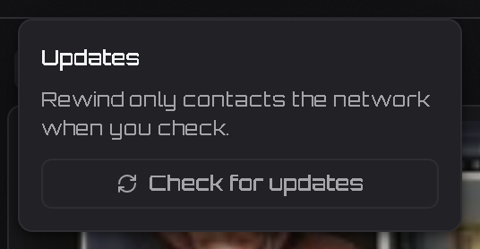

# Rewind and Revidi — A Public Statement

**Facts, dates, and evidence you can verify yourself.**

## TL;DR

I built **Rewind**, an open-source clipping tool inspired by Revidi, a closed-source application developed by toasterfork on Discord. He has accused me of stealing his code and threatened a DMCA takedown against this repository.

**On 10 October 2026 I contacted toasterfork on discord before starting my project asking for his blessing, and he approved it in writing** —his reply after 10minutes of my dm: *"Revidi is derivative at the end of the day it would be unfair for me to say no, so definitely go
  ahead"*, and *"there is no secret to what I've built."* **ask ur self if there is no secret why is he threatening me with a DMCA takedown on this repo?**
  
During the dispute I said some things in a another private conversation that were angry and unfair. I got emotional over watching my first project get called stolen and that got the better of me, and that is on me — I apologize.

It does not change a single fact in this statement

His evidence includes a folder name in my Git history: `Revidi-Clone`.

Let me be clear: **I have never had access to Revidi’s source code.** I used AI to study its externally observable behavior, then built my own implementation using the same publicly available OBS capture engine. Rewind has its own code, UI, features, architecture, and direction.

I credited Revidi as inspiration in my early README. The development history, dependencies, and source code are available for anyone to inspect.

I can't help but wonder if toasterfork is threatened by the idea of a free, open-source alternative competing with his cloud subscription model. Does he not see what's happening in the software industry? People are constantly building free, open-source alternatives to expensive commercial products, including alternatives to Adobe software. That's how competition works. No developer owns an entire category of software just because they built a product first.

Revidi still lacks 120 FPS recording to this day, puts its editor behind a paywall despite advertising free local use, and — per its own privacy policy — ships Mixpanel analytics covering device information and public IP addresses while checking an update manifest roughly every four hours. Meanwhile, Rewind aims to offer gamers a lightweight, local-first clipping tool without unnecessary subscriptions, locked features, or complicated OBS setups.

The whole point of open-source software is that users deserve alternatives, developers can innovate, and people shouldn't have to pay for every feature just because someone decided to monetize it. Instead of treating a free alternative as a threat, why not compete by improving the product? If Revidi is genuinely better, users will choose it. If Rewind offers more value for free, users should have the freedom to choose that, too.

**Inspiration is not theft. A folder name is not evidence of copied code. Accusations are not proof.**

## How Long This Statement Stays

This statement exists to address the dispute, not define the project. It will remain public while the dispute is active. Once things have settled, either through direct resolution or a sustained period of silence or by a notice it will be taken down.

This repository isn't a fight; it's a recorder, and the front page will go back to being about the software.


## What actually happened

I started Rewind because I was frustrated with existing capture tools. Revidi was one of my inspirations, and I have never pretended otherwise.

Revidi is closed-source. I did not have its source code to copy. I used AI to analyze how it behaved as a user-facing application and developed my own implementation using the public OBS engine and other publicly available dependencies.

The distinction matters: Rewind is a local-first application with no server, cloud library, or sharing service. It is a different product built around a different set of priorities.

### Verifiable timeline

| Date | Repository history |
|---|---|
| Oct 10 | First commits; README initially titled Reflect, renamed to Rewind the same day (`c70b8c0`, `34bdc2f`). |
| Oct 11 | README explicitly thanked Revidi and linked to its website (`728ca57`). |
| Oct 13 | Attribution section shortened and link removed (`24fd699`). |
| Oct 15 | Revidi removed from the comparison table (`9923c11`). |
| Oct 15 | Git history rewritten to remove personal email addresses and local paths. |

## The folder name and Git history

Yes, the original working folder was named `Revidi-Clone`. I had not settled on a project name and used it as a temporary development folder while building the application.

The product itself was renamed **Reflect → Rewind** openly in the early commits. A working-directory name does not establish that source code was copied.

After this dispute began, I rewrote Git history using `git filter-branch` to remove my personal email address and local Windows paths. The obsolete folder name was removed in the same pass. Every commit now uses my GitHub noreply identity.

I should have communicated that change upfront. However, **this was a privacy cleanup, not an attempt to erase evidence**. Earlier history may still exist in forks or caches, and I will make no further history changes while this dispute remains open.

Verify it yourself:

- `git log --all -S 'Revidi-Clone'` — no remaining matches.
- `git log --format='%ae' | sort -u` — only `bulhaa1@users.noreply.github.com`.

## On the visual UI similarities

Both applications are built on the same open-source OBS engine
(`@streamlabs/obs-studio-node`), and a recorder on that engine must present
the same controls: buffer length, frame rate, quality tiers, encoder
selection (NVENC, AMF, QSV), and capture sources. Those parameters are
defined by OBS itself — its public, GPL-2.0 source and documentation say
what they are and what values they accept.

The interface is built exclusively from public, permissively-licensed
libraries — React and Tailwind CSS (MIT), lucide-react (ISC) for icons.
When two apps use the same icon library, the icons are identical by
definition; the dependency is declared in `package.json` for anyone to
verify.

Rewind's development has always been open about studying Revidi's behavior
as an application, so it is no secret that the settings organization and
some labels will feel familiar. Where they coincide, they are short
functional phrases — the same words any recorder needs on the same screen.

## On the code-theft accusations

Three facts matter:

- **I never had Revidi's source code.** It is a closed-source application.
- **Both applications use the same public capture technology.** Revidi's own [privacy policy](https://revidi.app/privacy) identifies `@streamlabs/obs-studio-node`, the same OBS-based package used by Rewind.
- **Similar functionality does not establish copied source code.** Replay buffers, hotkeys, recording, and game detection are features that can be independently implemented.

  
**Revidi's internal implementation is unknown to me. The code available for inspection is Rewind's, and it is public. The code itself is independently generated: my AI agent worked from public dependencies, OBS's public documentation, and my own direction. Revidi'ssource code was never an input — it was never available. Where any generated code resembles anything, it reflects the same public libraries and the same engine, not access to Revidi's files.**


## Revidi vs. Rewind

| Feature | Revidi | Rewind |
|---|---|---|
| Replay buffer and hotkey clips | Yes | Yes |
| Automatic game detection | Yes | Yes |
| Start/stop recording and screenshots | Yes | Yes |
| Built-in clip trimming | Premium | Free |
| Audio mixing | Yes | Live faders and waveforms |
| Compression / re-encoding | Cloud editing | Local GPU or CPU encoding |
| Capture profiles | Not documented | Four, user-defined |
| Cloud sharing and library | Premium | None |
| Account | Optional; required for cloud | None |
| Analytics | Mixpanel, including IP address, per [privacy policy](https://revidi.app/privacy) | None |
| Updates | Automatic, approximately every four hours per policy | Manual checks only |
| Capture engine | OBS via `@streamlabs/obs-studio-node` | Same public package |
| Source code | Closed-source, all rights reserved | Open-source, GPL-2.0-or-later |
| Price | Free tier and $5 premium subscription | Free |

The key difference is not complicated: Revidi offers cloud features, while Rewind prioritizes local recording, privacy, and free access.

## What the source code actually shows

Rewind's publicly inspectable stack includes:

- **Application:** Electron 30, TypeScript, and Vite.
- **Interface:** React 18, Tailwind CSS 4, Base UI, and TanStack Query.
- **Capture:** `@streamlabs/obs-studio-node`, using the public OBS engine under GPL-2.0.
- **Encoding:** FFmpeg, with NVENC, AMF, QSV, and CPU fallback.
- **System integration:** `koffi`, `uiohook-napi`, `get-windows`, and `native-sound-mixer`.

The application is organized into `src/main`, `src/preload`, `src/renderer`, and `src/shared`, with 58 readable source files. Its dependencies and their licences are documented in the README.

There is exactly one occurrence of `revidi` in the source directory. Run:

`git grep -in revidi -- src`

It appears in `src/main/game-detector.ts` as part of a process-exclusion list:

```ts
'electron', 'rewind', 'revidi', 'obs64', 'obs32', 'streamlabs',
```

That list prevents Rewind from capturing itself, OBS, Streamlabs, and other capture-related processes. It is not copied application logic.

There is also no cloud implementation to clone. Run:

`git grep -nE 'axios|XMLHttpRequest|https?://' -- src`

The matches are limited to development configuration, browser links, an SVG background, and a thumbnail-reading function that works over IPC. The only outbound networking feature is `electron-updater`, triggered when the user manually checks for updates.

**A local-first clipping application without Revidi's cloud infrastructure is not a reproduction of its entire product.** The OBS integration both applications use is publicly available to begin with.

## Privacy: the documented differences

According to [Revidi's own privacy policy](https://revidi.app/privacy):

- Its desktop application sends Mixpanel analytics covering launches, clip saves, failures, OBS errors, device information, and public IP addresses.
- It checks an Amazon S3 update manifest approximately every four hours.
- Premium cloud uploads use Supabase storage, with associated clip and account metadata.

Rewind has no analytics SDK, account system, crash-reporting service, cloud storage, or background update polling. Update checks are manual.

These are differences in the products' documented designs, not allegations of wrongdoing against Revidi. Users can inspect Rewind's code and make their own assessment.

## If a DMCA notice is filed

Copyright disputes should be based on evidence of infringement, not assumptions drawn from a product's purpose, features, or a temporary folder name.

Revidi's source code was never available to me. Rewind's implementation uses public dependencies, and its development history and source code are available for inspection. Anyone making an allegation should identify the specific material they believe infringes their copyright.

If a notice is filed, I will respond through GitHub's applicable counter-notice process under 17 U.S.C. § 512(g), where appropriate. I remain open to resolving this directly, but I will not accept an accusation of code theft as established fact simply because the applications share a purpose.

## Auditable by design

Rewind includes verification commands covering its real application paths, including `npm run selftest`, `test:display`, `test:resolution`, `test:profiles`, `test:ui`, and the CI `verify:channels` check.

The source is open. The dependencies are identifiable. The implementation can be examined. **I welcome scrutiny of the actual code; I reject unsupported accusations about code nobody has shown me.**

## Judge for yourself

Download [Revidi](https://revidi.app/) and [Rewind](https://github.com/bulhaa1/Rewind/releases). Run them side by side. Inspect the repository. Check the dependencies and commits.

I have openly acknowledged what inspired Rewind. I have never claimed to have invented the concept of game clipping, and I have never had Revidi's source code.

**If there is evidence of copied code, identify it. If there isn't, stop presenting suspicion as proof.**

The capture engine is shared. The source code is not established to be shared. Judge the applications on the evidence, not on the name of a folder or the fact that one inspired the other.


# Rewind


Have you ever wanted a simple, lightweight way to clip your gameplay or take screenshots without a bulky overlay, unnecessary background processes, or an app that gets in the way?

Rewind is built for exactly that.

Modern capture tools like NVIDIA ShadowPlay and AMD Radeon ReLive offer convenient recording features, but they can introduce overhead and come with extra software and features you may not need. In competitive gaming, every frame and every millisecond matters. You shouldn't have to sacrifice performance or clutter your desktop just to save a great moment.

Rewind takes a different approach: keep it lightweight, stay out of the way, and capture what matters.

🎮 Instant Replay — Save those incredible plays, clutch rounds, and unexpected moments without recording your entire session manually.

📹 Screen and Game Recording — Start recording when you need it and stop when you're done.

📸 Quick Screenshots — Capture important moments with minimal interruption.

✂️ Local Clip Management — Browse, organize, and edit your clips without relying on a cloud service.

🗜️ Compress and Share — Trim a clip, mix its audio tracks, and write a smaller copy next to it — at the source's own resolution, encoded on your GPU.

🎛️ Capture Profiles — Four presets you define yourself: how much footage is kept, how smooth it is, how good it looks.

🔒 Privacy First — Your recordings stay on your drive. No account required, no cloud uploads, and no telemetry. Your gameplay is yours.

⚡ Designed to Stay Out of the Way — A compact, unobtrusive experience focused on doing the job without unnecessary overlays or background clutter.

Rewind is built around a simple idea: your capture software should work for you, not get in your way.

No unnecessary distractions. No cloud dependency. Just your gameplay, captured locally.

Rewind — Play. Capture. Keep.

## What's new in 1.4.1

Hotfix. `Rewind.exe` was never stamped with Rewind's name and icon — Task Manager showed
the app as **Electron**, and the icon in Explorer, the Start menu and the taskbar was
Electron's. The packaging step now fetches the missing tool instead of stopping quietly,
so the app carries its own icon, name and version. Everything from 1.4.0 is in this
build. Full note: [`docs/release-notes-1.4.1.md`](docs/release-notes-1.4.1.md).

## What's new in 1.4.0

Your library has a folder structure, and per-app audio works. Full note:
[`docs/release-notes-1.4.0.md`](docs/release-notes-1.4.0.md).

- **Recordings have their own folder.** `<location>\Rewind\Recordings` for continuous
  recordings, one folder per game for replay clips, `Screenshots\` for screenshots and
  `Compressed\` for editor exports — no loose video in the root. Your existing files are
  moved into place once, on first launch.
- **Per-app audio faders work.** Every app playing sound gets its own level in
  Settings → Audio; they were all greyed out before.
- **Add your own profiles** in Settings → Profiles, up to four.
- **Storage usage** in Settings → Storage: what each folder takes, and the free space on
  the drive.
- **A portable zip** on the releases page: unzip it anywhere and run `Rewind.exe`.

## What's new in 1.3.1

Hotfix for 1.3.0: **every clip and recording came out black** in that build. Monitor
capture now uses Windows Graphics Capture rather than DXGI duplication, which was
returning no frames. Clips already recorded with 1.3.0 cannot be recovered. Also here:
the **Record** row fades out while the buffer is off, and the redundant "Auto detect
launched game" card is gone from Settings → Capture Source (picking **Game Capture**
already means auto-detect). Full note:
[`docs/release-notes-1.3.1.md`](docs/release-notes-1.3.1.md).

## What's new in 1.3.0

The clip editor grew up, and compression moved to your GPU. The full list is in
[`docs/release-notes-1.3.0.md`](docs/release-notes-1.3.0.md).

- **A real editor.** Trim with draggable in/out handles or the mouse wheel over the
  trim bar, watch a waveform for every audio lane, drag each track's volume and hear
  it as you move it. Save a trimmed copy, or replace the original.
- **Compress,** One **Compress** box with **Low / Medium / High** — each
  is a fraction of the clip's own bitrate, so the copy can never come out bigger than
  the original. It encodes with NVENC, AMF or QSV when your GPU offers one and falls
  back to a threaded CPU encode when it does not. Copies land in `Rewind/Compressed/`.
- **Profiles you own.** Add, duplicate, remove and re-save up to four capture presets,
  switched from the panel or from Settings.
- **Smaller, quieter, better behaved.** The audio service moved into the main process,
  the panel stops working while it is hidden, and the packaged engine no longer ships
  a browser engine or plugins Rewind never loads — the installer is **107 MB**, down
  from 189 MB in 1.1.0. Plus a screen-resolution change that no longer needs a
  restart, a silent updater that clears its own cache, and a pile of correctness fixes
  from a full-repository audit.

## Preview


## Install

Go to releases. Download `Rewind-<version>-setup.exe` and run it. Per-user install, no admin, no
account.

There is also `Rewind-<version>-portable.zip`: unpack it anywhere and run `Rewind.exe`. It is the
same app with no installer and no registry entry — settings, clips and screenshots still live in
the usual per-user places, and the in-app updater is off, because updating a portable copy would
install a second one. To move up a version, download the new zip.

Recording, editing and clips are all local files. Rewind contains no analytics,
no telemetry and no crash reporting, and it makes no network request on its own —
the only way it ever contacts the network is if you press **Check for updates**
in the header (see [Updating](#updating)). Nothing polls, nothing downloads
unasked, and quitting the app does not install an update you have not applied.

**Windows x64 only.** There is no ARM or 32-bit build and no non-Windows build YET.

## Using it

Rewind lives in the system tray, and the panel opens from the tray icon. These four
work whether the panel is open or closed:

| Key | Action |
|---|---|
| `Alt+1` | Save the whole replay buffer as a clip |
| `Ctrl+Alt+1` | Save only the last N seconds, at a length you pick on the panel |
| `Alt+2` | Take a screenshot of the captured display |
| `Alt+3` | Start / stop a continuous recording |

All four are rebindable in Settings. The buffer keeps rolling while the panel is
closed, so closing the window never costs you a clip. The strip along the bottom of
the panel shows how much is buffered at that moment.

A profile is a preset for how much footage is kept, how smooth it is and how good it
looks — a long low-impact buffer for background use, a short high-quality one for a
moment worth keeping. Profiles are yours to define in Settings → Profiles (four at
most), and the panel's numbered buttons switch between them.

Clips, screenshots and the editor are all reachable from the tray menu.

## Editing and compressing

click a clip to open the editor in its own window:

- **Trim** by dragging the in/out handles, or scroll the wheel over the trim bar to
  scrub. The selection is what gets saved.
- **Mix the audio** — every track in the clip gets its own lane, its own waveform and
  its own volume. Dragging a fader is heard live, and a fader at zero is the mute.
- **Replace original** writes the trimmed range over the clip you opened;
  **Save a copy** writes it beside the clip as `name-edit.mp4`. The editor header
  shows the file name and its size on disk.

**Compress** in the same window makes a smaller copy without touching the original.
Pick **Low**, **Medium** or **High** — each is a fraction of the clip's own bitrate
(40% / 65% / 90%), so the result is always smaller than the source and the readout
tells you by how much before you commit. The copy keeps the source resolution and
lands in `Rewind/Compressed/`, which the library shows as its own source. Encoding
runs on the GPU when one is available (NVENC, AMF or QSV); if it has to fall back to
the CPU, **Settings → Encoder → Compression Threads** decides how many threads it may
use.

The **Copy clip** item in the rail's card menu puts the clip file on the clipboard,
so it can be pasted straight into a chat.

## Updating

Rewind is privacy-first, and the updater is built the same way: **it never checks
for updates on its own.** There is no background poll, no silent download, and
quitting the app never installs anything. You only hear about a new version when
you go looking for it.

To update:

1. Click the download-arrow icon at the top-right of the panel, next to the
   settings gear.
2. Press **Check for updates**.
3. If a version is available, press **Download**, then **Restart and install**.
   The installer runs silently — no wizard, no clicks — and the app comes back up
   on the new version. Your clips, settings and hotkeys carry over, and what the
   updater downloaded is cleared from disk shortly afterwards instead of piling up.



The same tab shows why if a check fails, and nothing is ever downloaded until you
press Download.

What your machine can encode, and what Rewind does when it cannot, is documented in
[`docs/hardware-compatibility.md`](docs/hardware-compatibility.md) — including a
checklist for a machine nobody has tried yet.

## How it compares

| Tool | Price | Replay Buffer | Any GPU | Standalone App | Extra Bloat | Data Collection | Setup Difficulty | Customizability |
|---|---|---|---|---|---|---|---|---|
| **Rewind** | **Free · Open Source** | **Yes** | **Yes** | **Yes** | **None** | **None** | **Super Easy** | **9/10** |
| Medal.tv | Free (Premium available) | Yes | Yes | Yes | Yes | Yes | Medium | 7/10 |
| NVIDIA ShadowPlay | Free | Yes | No | Part of NVIDIA App | Yes | Can Opt Out | Easy | 7/10 |
| AMD ReLive | Free | Yes | No | Part of AMD Adrenalin | Yes | Can Opt Out | Easy | 6/10 |
| Outplayed | Free | Yes | Yes | Part of Overwolf | Yes | Yes | Medium | 7.5/10 |
| SteelSeries Moments | Free | Yes | Yes | Part of SteelSeries GG | Yes | Yes | Medium | 7/10 |
| OBS Studio | Free · Open Source | Yes | Yes | Yes | None | None | Very Hard | 10/10 |
| Xbox Game Bar | Free · Built into Windows | Yes | Yes | Built into Windows | Yes | Yes | done for u | 2/10 |

Rewind detects the encoder your GPU offers — NVENC, AMF or QSV — and falls back
to CPU encoding when it finds none, so it runs on any of them rather than being
tied to one vendor. It is also its own installer: no Overwolf, no Adrenalin, no
NVIDIA App running underneath it.

Rewind is the least system resource taking app out of them all. It's purposefully
built with a simple UI to make it lightweight, so anyone — even on a potato PC — can
clip their favorite moments without a major frame-rate hit.

The share-link column is the one place Rewind is behind on purpose. Everyone
else's version of that feature means your clips go through someone else's server.
Rewind has no server.

Competitor details are approximate and go stale — pricing and features change.
Check the others before relying on them.

## Development

```bash
npm install
npm run dev          # run against node_modules
npm run build        # compile main + renderer
npm start            # build then run
npm run package      # build the NSIS installer into release/
npm run package:portable  # zip the packaged app into release/ as Rewind-<version>-portable.zip
```

Verification, per area — each one runs the real path and reports what it measured:

```bash
npm run test:ui            # the panel regression suite (needs a running app on CDP 9222)
npm run test:display       # the capture canvas follows the display, buffer live or paused
npm run test:resolution    # a real display mode change, both directions (blanks the screen briefly)
npm run test:profiles      # the four presets: tiers, write-through, pause preservation
npm run test:update-cache  # the updater cache is emptied on start
npm run test:update        # an installed 1.1.0 -> this build, against a local feed
npm run selftest           # save, screenshot and library paths end to end
```

Native modules must be built against Electron's ABI first:

```bash
npm run rebuild
```

This is already done for `npm run dev` and `npm run package`; you only need it
after a fresh `npm install` or an Electron upgrade.

## Licence

GPL-2.0-or-later. See [LICENSE](LICENSE).

`GPL-2.0-or-later` rather than `GPL-2.0` because `ffmpeg-static` is
GPL-3.0-or-later, and bare `GPL-2.0` in SPDX terms means *-only*, which cannot be
combined with GPL-3.0. OBS Studio and `obs-studio-node` are GPL-2.0.

Inspired by work from toasterfork on Discord. Rewind is an entirely independent implementation designed by analyzing external software behavior and building equivalent functionality on top of the OBS engine.

Bundled third-party components keep their own licences, including OBS Studio
(GPL-2.0), ffmpeg (GPL), koffi (MIT), uiohook-napi (MIT) and Electron (MIT).
