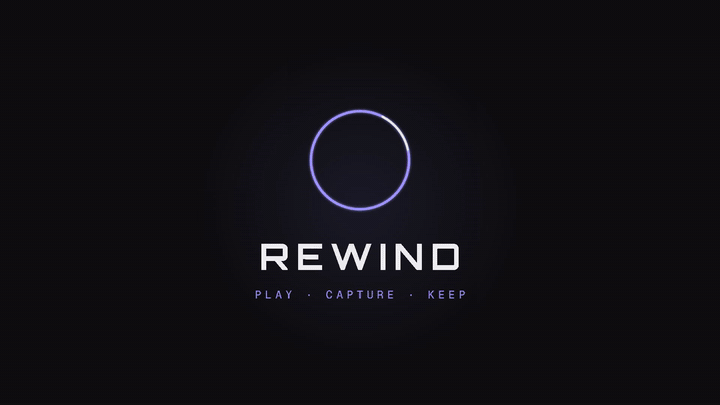
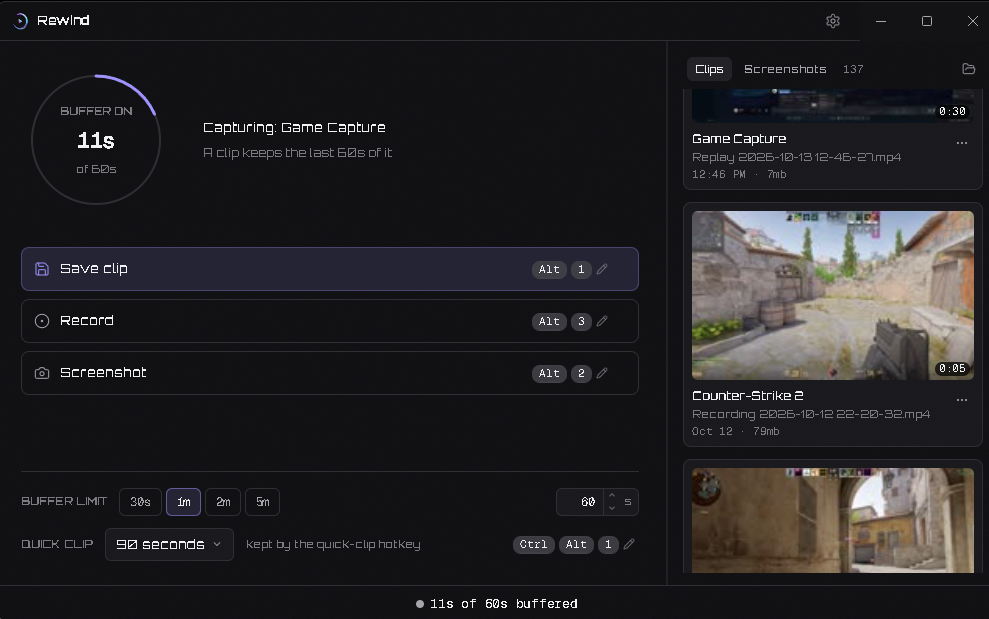
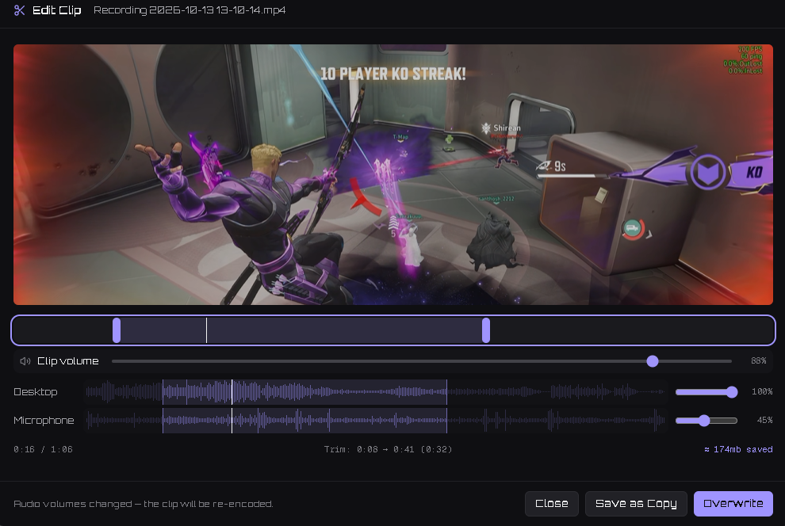
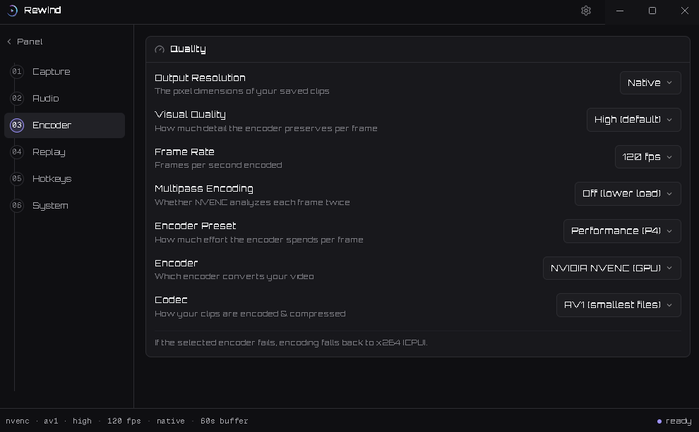

# Rewind

> **The story of Rewind** — why this project exists, the dispute that came with it, and how it ended: **[the story of Rewind](docs/the-story-of-rewind.md)**.

> **Rewind is end of life.** Development has stopped, and 1.5.0 is the final release. The app keeps working as it is, and the source stays public under GPL-2.0-or-later — fork it and build on it. The update button no longer checks for anything.




Have you ever wanted a simple, lightweight way to clip your gameplay or take screenshots without a bulky overlay, unnecessary background processes, or an app that gets in the way?

Rewind is built for exactly that.

Modern capture tools like NVIDIA ShadowPlay and AMD Radeon ReLive offer convenient recording features, but they can introduce overhead and come with extra software and features you may not need. In competitive gaming, every frame and every millisecond matters. You shouldn't have to sacrifice performance or clutter your desktop just to save a great moment.

Rewind takes a different approach: keep it lightweight, stay out of the way, and capture what matters.

🎮 Instant Replay — Save those incredible plays, clutch rounds, and unexpected moments without recording your entire session manually.

📹 Screen and Game Recording — Start recording when you need it and stop when you're done.

📸 Quick Screenshots — Capture important moments with minimal interruption.

✂️ Local Clip Management — Browse, organize, and edit your clips without relying on a cloud service.

🗜️ Compress and Share — Trim a clip, mix its audio tracks, and write a smaller copy next to it — at the source's own resolution, encoded on your GPU.

🎛️ Capture Profiles — Four presets you define yourself: how much footage is kept, how smooth it is, how good it looks.

🔒 Privacy First — Your recordings stay on your drive. No account required, no cloud uploads, and no telemetry. Your gameplay is yours.

⚡ Designed to Stay Out of the Way — A compact, unobtrusive experience focused on doing the job without unnecessary overlays or background clutter.

Rewind is built around a simple idea: your capture software should work for you, not get in your way.

No unnecessary distractions. No cloud dependency. Just your gameplay, captured locally.

Rewind — Play. Capture. Keep.

## What's new in 1.5.0

The final release. Rewind is end of life after this version — see the banner above.

- **Encoder Preset** — Low / Balanced / Quality replaces the four-tier Visual Quality (CQP 28 / 23 / 16). Your saved setting and profiles migrate automatically.
- **Screenshot editor** — click a screenshot to crop it and adjust brightness, contrast and saturation. Saving overwrites the original after a confirm; Revert crop restores the untouched image.
- **Themes** — Graphite, Terminal and Grotesk, each with its own interface font, switchable from the titlebar.
- **Microphone picker fixes** — every input is listed by name, including what "Windows Default" resolves to, and a device is never captured twice.
- **Fixed: quarter-screen recordings** on displays with scaling (200% and similar) — the capture is now fitted from the source's real frame size.
- **Fixed:** a crash loop when the capture engine reinitialised mid-switch, and elevated games being dropped from capture.
- **Removed:** the Discord button. The update panel no longer contacts the network — the app now makes no network request at all.

## What's new in 1.4.1

Hotfix. `Rewind.exe` was never stamped with Rewind's name and icon — Task Manager showed
the app as **Electron**, and the icon in Explorer, the Start menu and the taskbar was
Electron's. The packaging step now fetches the missing tool instead of stopping quietly,
so the app carries its own icon, name and version. Everything from 1.4.0 is in this
build. Full note: [`docs/release-notes-1.4.1.md`](docs/release-notes-1.4.1.md).

## What's new in 1.4.0

Your library has a folder structure, and per-app audio works. Full note:
[`docs/release-notes-1.4.0.md`](docs/release-notes-1.4.0.md).

- **Recordings have their own folder.** `<location>\Rewind\Recordings` for continuous
  recordings, one folder per game for replay clips, `Screenshots\` for screenshots and
  `Compressed\` for editor exports — no loose video in the root. Your existing files are
  moved into place once, on first launch.
- **Per-app audio faders work.** Every app playing sound gets its own level in
  Settings → Audio; they were all greyed out before.
- **Add your own profiles** in Settings → Profiles, up to four.
- **Storage usage** in Settings → Storage: what each folder takes, and the free space on
  the drive.
- **A portable zip** on the releases page: unzip it anywhere and run `Rewind.exe`.

## What's new in 1.3.1

Hotfix for 1.3.0: **every clip and recording came out black** in that build. Monitor
capture now uses Windows Graphics Capture rather than DXGI duplication, which was
returning no frames. Clips already recorded with 1.3.0 cannot be recovered. Also here:
the **Record** row fades out while the buffer is off, and the redundant "Auto detect
launched game" card is gone from Settings → Capture Source (picking **Game Capture**
already means auto-detect). Full note:
[`docs/release-notes-1.3.1.md`](docs/release-notes-1.3.1.md).

## What's new in 1.3.0

The clip editor grew up, and compression moved to your GPU. The full list is in
[`docs/release-notes-1.3.0.md`](docs/release-notes-1.3.0.md).

- **A real editor.** Trim with draggable in/out handles or the mouse wheel over the
  trim bar, watch a waveform for every audio lane, drag each track's volume and hear
  it as you move it. Save a trimmed copy, or replace the original.
- **Compress,** One **Compress** box with **Low / Medium / High** — each
  is a fraction of the clip's own bitrate, so the copy can never come out bigger than
  the original. It encodes with NVENC, AMF or QSV when your GPU offers one and falls
  back to a threaded CPU encode when it does not. Copies land in `Rewind/Compressed/`.
- **Profiles you own.** Add, duplicate, remove and re-save up to four capture presets,
  switched from the panel or from Settings.
- **Smaller, quieter, better behaved.** The audio service moved into the main process,
  the panel stops working while it is hidden, and the packaged engine no longer ships
  a browser engine or plugins Rewind never loads — the installer is **107 MB**, down
  from 189 MB in 1.1.0. Plus a screen-resolution change that no longer needs a
  restart, a silent updater that clears its own cache, and a pile of correctness fixes
  from a full-repository audit.

## Preview







## Install

Go to releases. Download `Rewind-<version>-setup.exe` and run it. Per-user install, no admin, no
account.

There is also `Rewind-<version>-portable.zip`: unpack it anywhere and run `Rewind.exe`. It is the
same app with no installer and no registry entry — settings, clips and screenshots still live in
the usual per-user places, and the in-app updater is off, because updating a portable copy would
install a second one. To move up a version, download the new zip.

Recording, editing and clips are all local files. Rewind contains no analytics,
no telemetry and no crash reporting, and it makes no network request at all —
since 1.5.0 even the manual update check is gone (see [Updating](#updating)).
Nothing polls, nothing downloads anything, and nothing is ever uploaded.

**Windows x64 only.** There is no ARM or 32-bit build and no non-Windows build YET.

## Using it

Rewind lives in the system tray, and the panel opens from the tray icon. These four
work whether the panel is open or closed:

| Key | Action |
|---|---|
| `Alt+1` | Save the whole replay buffer as a clip |
| `Ctrl+Alt+1` | Save only the last N seconds, at a length you pick on the panel |
| `Alt+2` | Take a screenshot of the captured display |
| `Alt+3` | Start / stop a continuous recording |

All four are rebindable in Settings. The buffer keeps rolling while the panel is
closed, so closing the window never costs you a clip. The strip along the bottom of
the panel shows how much is buffered at that moment.

A profile is a preset for how much footage is kept, how smooth it is and how good it
looks — a long low-impact buffer for background use, a short high-quality one for a
moment worth keeping. Profiles are yours to define in Settings → Profiles (four at
most), and the panel's numbered buttons switch between them.

Clips, screenshots and the editor are all reachable from the tray menu.

## Editing and compressing

click a clip to open the editor in its own window:

- **Trim** by dragging the in/out handles, or scroll the wheel over the trim bar to
  scrub. The selection is what gets saved.
- **Mix the audio** — every track in the clip gets its own lane, its own waveform and
  its own volume. Dragging a fader is heard live, and a fader at zero is the mute.
- **Replace original** writes the trimmed range over the clip you opened;
  **Save a copy** writes it beside the clip as `name-edit.mp4`. The editor header
  shows the file name and its size on disk.

**Compress** in the same window makes a smaller copy without touching the original.
Pick **Low**, **Medium** or **High** — each is a fraction of the clip's own bitrate
(40% / 65% / 90%), so the result is always smaller than the source and the readout
tells you by how much before you commit. The copy keeps the source resolution and
lands in `Rewind/Compressed/`, which the library shows as its own source. Encoding
runs on the GPU when one is available (NVENC, AMF or QSV); if it has to fall back to
the CPU, **Settings → Encoder → Compression Threads** decides how many threads it may
use.

The **Copy clip** item in the rail's card menu puts the clip file on the clipboard,
so it can be pasted straight into a chat.

## Updating

Rewind is end of life, and 1.5.0 is the last version. **The update button no longer
checks for updates** — it explains that development has stopped and links to the
source. The app makes no network request, ever: no check, no download, no install.
If a new version ever appears on this repository's releases page, download it from
there by hand.

What your machine can encode, and what Rewind does when it cannot, is documented in
[`docs/hardware-compatibility.md`](docs/hardware-compatibility.md) — including a
checklist for a machine nobody has tried yet.

## How it compares

| Tool | Price | Replay Buffer | Any GPU | Standalone App | Extra Bloat | Data Collection | Setup Difficulty | Customizability |
|---|---|---|---|---|---|---|---|---|
| **Rewind** | **Free · Open Source** | **Yes** | **Yes** | **Yes** | **None** | **None** | **Super Easy** | **9/10** |
| Medal.tv | Free (Premium available) | Yes | Yes | Yes | Yes | Yes | Medium | 7/10 |
| NVIDIA ShadowPlay | Free | Yes | No | Part of NVIDIA App | Yes | Can Opt Out | Easy | 7/10 |
| AMD ReLive | Free | Yes | No | Part of AMD Adrenalin | Yes | Can Opt Out | Easy | 6/10 |
| Outplayed | Free | Yes | Yes | Part of Overwolf | Yes | Yes | Medium | 7.5/10 |
| SteelSeries Moments | Free | Yes | Yes | Part of SteelSeries GG | Yes | Yes | Medium | 7/10 |
| OBS Studio | Free · Open Source | Yes | Yes | Yes | None | None | Very Hard | 10/10 |
| Xbox Game Bar | Free · Built into Windows | Yes | Yes | Built into Windows | Yes | Yes | done for u | 2/10 |

Rewind detects the encoder your GPU offers — NVENC, AMF or QSV — and falls back
to CPU encoding when it finds none, so it runs on any of them rather than being
tied to one vendor. It is also its own installer: no Overwolf, no Adrenalin, no
NVIDIA App running underneath it.

Rewind is the least system resource taking app out of them all. It's purposefully
built with a simple UI to make it lightweight, so anyone — even on a potato PC — can
clip their favorite moments without a major frame-rate hit.

The share-link column is the one place Rewind is behind on purpose. Everyone
else's version of that feature means your clips go through someone else's server.
Rewind has no server.

Competitor details are approximate and go stale — pricing and features change.
Check the others before relying on them.

## Development

```bash
npm install
npm run dev          # run against node_modules
npm run build        # compile main + renderer
npm start            # build then run
npm run package      # build the NSIS installer into release/
npm run package:portable  # zip the packaged app into release/ as Rewind-<version>-portable.zip
```

Verification, per area — each one runs the real path and reports what it measured:

```bash
npm run test:ui            # the panel regression suite (needs a running app on CDP 9222)
npm run test:display       # the capture canvas follows the display, buffer live or paused
npm run test:resolution    # a real display mode change, both directions (blanks the screen briefly)
npm run test:profiles      # the four presets: tiers, write-through, pause preservation
npm run test:update-cache  # the updater cache is emptied on start
npm run test:update        # an installed 1.1.0 -> this build, against a local feed
npm run selftest           # save, screenshot and library paths end to end
```

Native modules must be built against Electron's ABI first:

```bash
npm run rebuild
```

This is already done for `npm run dev` and `npm run package`; you only need it
after a fresh `npm install` or an Electron upgrade.

## Licence

GPL-2.0-or-later. See [LICENSE](LICENSE).

`GPL-2.0-or-later` rather than `GPL-2.0` because `ffmpeg-static` is
GPL-3.0-or-later, and bare `GPL-2.0` in SPDX terms means *-only*, which cannot be
combined with GPL-3.0. OBS Studio and `obs-studio-node` are GPL-2.0.

Inspired by work from toasterfork on Discord. Rewind is an entirely independent implementation designed by analyzing external software behavior and building equivalent functionality on top of the OBS engine.

Bundled third-party components keep their own licences, including OBS Studio
(GPL-2.0), ffmpeg (GPL), koffi (MIT), uiohook-napi (MIT) and Electron (MIT).
