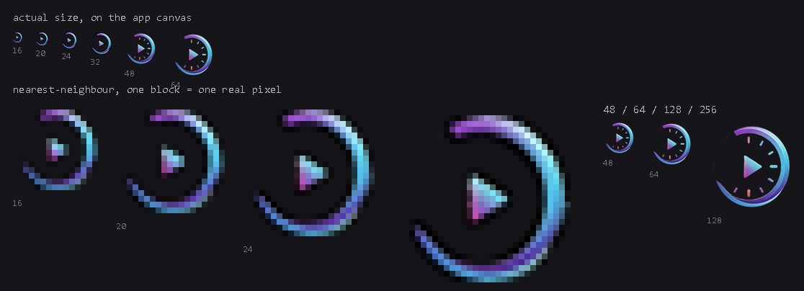

# Rewind

A lightweight replay buffer for Windows. It keeps the last few seconds on a
rolling buffer so you can pull out a moment *after* it happened — hotkey-driven
and tray-resident.

Built on OBS Studio's engine (`obs-studio-node`). None of OBS's concepts appear on
the surface: you press a key, you get a clip.



## Install

Download `Rewind-<version>-setup.exe` and run it. Per-user install, no admin, no
account.

Recording, editing and clips are all local files. Rewind contains no analytics,
no telemetry and no crash reporting, and it makes no network request on its own —
the only way it ever contacts the network is if you press **Check for updates**
in the header. Nothing polls, nothing downloads unasked, and quitting the app
does not install an update you have not applied.

**Windows x64 only.** There is no ARM or 32-bit build and no non-Windows build.

## Using it

Rewind lives in the system tray. The panel opens from the tray, or with the
global hotkeys:

| Key | Action |
|---|---|
| `Alt+1` | Open / close the panel |
| `Alt+2` | Save the buffer as a clip |

The buffer keeps rolling while the panel is closed. Recording state is shown by the
ring filling — there is no red dot to misread.

Clips, screenshots and the editor are all reachable from the tray menu.

## How it compares

| Tool | Price | Replay buffer | Any GPU | Standalone app | Instant share link |
|---|---|---|---|---|---|
| **Rewind** | **Free · open source** | **Yes** | **Yes** | **Yes** | No — deliberately: no cloud, no account, no telemetry |
| Medal.tv | Free (Premium available) | Yes | Yes | Yes | Yes |
| Revidi | Free (Premium $4.99/mo) | Yes | Yes | Yes | Yes |
| NVIDIA ShadowPlay | Free | Yes (Instant Replay) | No | Part of the NVIDIA App | No |
| AMD ReLive | Free | Yes | No | Part of AMD Adrenalin | No |
| Outplayed | Free | Yes | Yes | Runs on the Overwolf platform | Yes |
| SteelSeries Moments | Free | Yes | Yes | Part of SteelSeries GG | Yes (in-app) |
| OBS Studio | Free (open source) | Yes | Yes | Yes | No |
| Xbox Game Bar | Free (built into Windows) | Yes (background recording) | Yes | Built into Windows | No |

Rewind detects the encoder your GPU offers — NVENC, AMF or QSV — and falls back
to CPU encoding when it finds none, so it runs on any of them rather than being
tied to one vendor. It is also its own installer: no Overwolf, no Adrenalin, no
NVIDIA App running underneath it.

The share-link column is the one place Rewind is behind on purpose. Everyone
else's version of that feature means your clips go through someone else's server.
Rewind has no server.

Competitor details are approximate and go stale — pricing and features change.
Check the others before relying on them.

## Development

```bash
npm install
npm run dev          # run against node_modules
npm run build        # compile main + renderer
npm start            # build then run
npm run package      # build the NSIS installer into release/
```

Native modules must be built against Electron's ABI first:

```bash
npm run rebuild
```

This is already done for `npm run dev` and `npm run package`; you only need it
after a fresh `npm install` or an Electron upgrade.

### Verification

There are no unit tests. Verification is done by driving a real, running app:

```bash
npm run typecheck
npm run test:ui                      # 16 CDP checks against the live panel
npm run selftest                     # main-process self test
node scripts\recordtest.js 60 30     # record 30s at 60fps, then probe the file
node scripts\audiotest.js            # play a tone, measure the captured loudness
```

`scripts/probe-*.mjs` and `scripts/shot-*.mjs` are the harness. They connect to a
running app over the Chrome DevTools Protocol (`--remote-debugging-port=9222`).

Two rules learned the hard way, worth keeping:

- **`ffprobe` reading a file is not the same as it decoding.** Always run
  `ffmpeg -v error -i file -f null NUL` and check the exit code.
- **ffmpeg's `volumedetect` writes to stderr.** `execFileSync` returns stdout only,
  which will report a false PASS.

### Icons and palette

The brand artwork is generated into `assets/`:

```bash
npm run icons      # extract -> sizes -> .ico -> contact sheet
npm run palette    # sample the artwork -> oklch -> palette sheet
```

`DESIGN.md` explains the mark's geometry, why there are two sizes of it, and how
the accent hue was chosen.

## Known limitations

Stated plainly rather than discovered later:

- **60 fps records at 30.** OBS normalises `FPSType` back to `FPSType=0` on
  shutdown and the profile write does not survive it. 30 and 120 both produce the
  rate they claim; 60 does not. The option is still offered and is wrong.
- **Per-app audio mixing, extra device channels and `separateAudioTracks` are
  exposed in Settings but unverified.** They may work; they have not been tested.
- **Unsigned.** Windows SmartScreen will warn on first run, and on every update.

## Licence

GPL-2.0-or-later. See [LICENSE](LICENSE).

`GPL-2.0-or-later` rather than `GPL-2.0` because `ffmpeg-static` is
GPL-3.0-or-later, and bare `GPL-2.0` in SPDX terms means *-only*, which cannot be
combined with GPL-3.0. OBS Studio and `obs-studio-node` are GPL-2.0.

## Relationship to other software

Rewind is an independent reimplementation. It was written by observing the
behaviour of another product and rebuilding the functionality from the OBS engine
upwards; no third-party application code was copied into this repository.

Bundled third-party components keep their own licences, including OBS Studio
(GPL-2.0), ffmpeg (GPL), koffi (MIT), uiohook-napi (MIT) and Electron (MIT).
